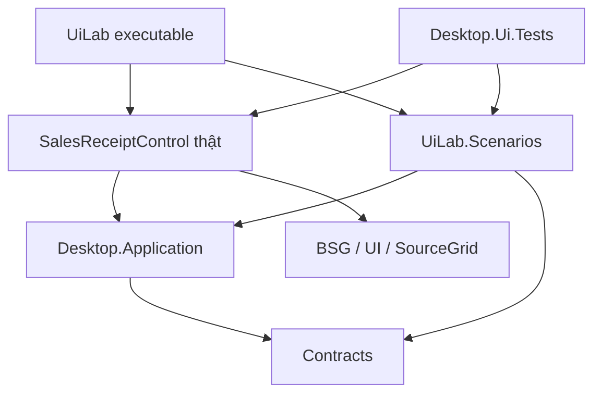

# Triển khai A0–A1: một đường đọc hiện hành và Sales UI Lab

**Ngày:** 24/10/2026. **Loại tài liệu:** hướng dẫn triển khai đề xuất, chưa kích hoạt công việc trong repo sản phẩm. Trạng thái lựa chọn chỉ ghi tại [bảng quyết định](2026-10-24-adoption.md#1-lựa-chọn). Việc commit hướng dẫn này không phải kết quả triển khai hoặc nghiệm thu A0/A1.

**Mục tiêu:** một developer/Codex tìm đúng việc hiện hành từ một điểm vào; mở, sửa và kiểm tra Sales workspace thật bằng dữ liệu giả lập, không cần SQL hoặc đăng nhập thật.

**Thiết kế:** hai PR nối tiếp trong `MyDmsVn`, cùng base `v1a-pro-ui-next`. A0 sửa điều hướng/trạng thái tài liệu. A1 thêm host WinForms nhỏ, scenario-support library và native test project; sử dụng control/ViewModel/contract hiện có. [Lộ trình gốc](2026-10-24-adoption.md#2-thứ-tự-đề-xuất-và-kết-quả-có-thể-xem-được) và [thiết kế prototype](2026-10-24-ui-prototyping.md) giải thích lựa chọn này.

**Nền tảng:** Windows tương tác, VS2022/toolchain hiện hành, .NET Framework 4.8, SDK do `global.json` chọn, xUnit hiện có. Các project/path/scenario mới dưới đây là **tên đề xuất**. Lệnh tương lai cần được chạy và ghi kết quả thật trên candidate triển khai.

**Trọng tâm review:** một nguồn tiến độ; không mất evidence cũ; Lab/test không reference Local/Server; fake phản ánh đúng request và session; UI thread, raw buffers, late responses và uncertain Post vẫn được bảo vệ. A0–A1 không phụ thuộc vào tạo repo mới, Web/API, đổi runtime hay gom toolkit.

## 1. Kết quả và thứ tự giao việc

| PR tương lai | Đầu ra có thể xem được | Điều kiện đóng |
|---|---|---|
| **PR 1 — A0: documentation entry and status cleanup** | Một đường đọc và một kế hoạch thực thi hiện hành; chỉ dẫn DateInput đã cũ được sửa/đánh dấu lịch sử | Các entry pages dẫn tới cùng queue; liên kết/evidence còn đúng; diff chỉ Markdown |
| **PR 2 — A1: native Sales UI Lab** | Chạy Sales list/editor thật bằng fixtures; chọn/reset kịch bản; test native riêng | Checkout sạch trên Windows chạy không cần SQL/credentials; sáu kịch bản đạt trong phạm vi khai báo; graph không kéo server |

PR 2 bắt đầu từ nhánh base sau khi PR 1 được merge. Có thể chuẩn bị thiết kế A1 sớm, nhưng không để hai PR cùng sửa các trạng thái hiện hành khác nhau. Mỗi PR vẫn có các commit nhỏ theo nhiệm vụ ở dưới.

Không cần chốt toàn bộ năm lựa chọn tổ chức để bắt đầu: có thể duyệt riêng phạm vi A0–A1. Việc đó không mặc nhiên duyệt tạo WinFormsKit, tách Client/Server, nâng runtime hoặc xóa test diện rộng. Khi được giao thực thi, ghi lại đúng phạm vi đã được chọn trong Docs; tiến độ task thuộc repo sản phẩm.

### Baseline cần chốt khi thực thi

Khảo sát này sử dụng `MyDmsVn@03acacdaea6a750aa88b33d61ea139379edcb326`. Các gitlink được tiêu thụ là BSG `e311144c27cd79a6c34aa0308ad029651c9e03c9`, UI `8ae217ea8aa9a938ebd558f7071dc737f909e6a5`, SourceGrid `f4e457b43582bf01892f50bdc74aa480531e5944`; xem [inventory và provenance](../assessments/2026-10-24-current-state.md).

Trước PR 1, đọc lại HEAD của `v1a-pro-ui-next`, root và scoped `AGENTS.md`, trạng thái working tree, `git submodule status --recursive`. Ghi delta so với baseline khảo sát nếu có. Checkout submodule theo gitlink của base; không dùng upstream HEAD hoặc `submodule update --remote` để vô tình đổi pins. Dùng branch/worktree sạch theo cách repo đang làm; không ghi đè thay đổi đang có của người dùng.

## 2. A0 — sửa bối cảnh hiện hành trong một PR

### A0.1 — xác định một nơi sở hữu từng loại thông tin

| Thông tin | Nơi sở hữu sau A0 |
|---|---|
| Vì sao tổ chức lại, phương án nào được chọn | `MyDmsVn.Docs`, tiếp tục dùng adoption document |
| Điểm vào công việc hiện hành | `MyDmsVn/docs/plans/README.md`, chỉ làm index |
| Tiến độ A0/A1, task và liên kết bằng chứng | Một plan mới: `docs/plans/20261024-001-a0-a1-sales-ui-lab.md` |
| Quy tắc ổn định cho Codex | `AGENTS.md`; dẫn tới index, không chép bảng tiến độ |
| Hệ thống đang chạy, contracts, bảo mật, persistence | Các tài liệu hiện hành trong repo sở hữu code |
| Chọn phạm vi test / coverage / lệnh chạy | Lần lượt `docs/TEST_POLICY.md`, `docs/TEST_STRATEGY.md`, `tests/README.md` |

`docs/DEVELOPMENT_PLAN.md` trở thành alias ngắn tới index. Không thêm `STATUS.md`, dashboard tiến độ hay một bản A0/A1 khác trong Docs. Tên ngày trong plan có thể đổi theo ngày thực thi; chỉ một file được index chọn làm hiện hành.

Plan mới chỉ cần: baseline, mục tiêu, giới hạn, một bảng A0/A1 và các nhiệm vụ con, verification, evidence/limitations. Không sao chép toàn bộ báo cáo khảo sát. Các trạng thái của DateInput vẫn là kết quả theo candidate cũ, không được chuyển thành PASS của candidate A1.

### A0.2 — sửa đúng các điểm đang gây mâu thuẫn

Tại baseline, một số entry pages còn ghi DateInput chưa bắt đầu và yêu cầu tiếp tục PR #45, trong khi roadmap/evidence đã ghi kết quả sau đó. Đây là mâu thuẫn có thật ở tài liệu, không phải lý do để chạy lại toàn bộ SQL/GUI. [S1][S2]

| File hiện hữu trong `MyDmsVn` | Thay đổi cần làm |
|---|---|
| `README.md`, `AGENTS.md`, `AI_CONTEXT.md`, `docs/README.md` | Trỏ tới plan index; bỏ đoạn giao việc hiện hành đã cũ; giữ invariants và các baseline được ghi rõ là lịch sử |
| `docs/plans/README.md` | Trỏ tới plan A0/A1 mới; giữ liên kết lịch sử cần thiết |
| `docs/DEVELOPMENT_PLAN.md` | Rút thành alias; bỏ bảng/trạng thái hiện hành bị lặp |
| `docs/TEST_POLICY.md`, `docs/TEST_STRATEGY.md`, `tests/README.md` | Sửa phần định tuyến/current work; giữ policy, coverage owners và commands còn đúng |
| `docs/ui-next/README.md`, `docs/ui-next/20261023-active-roadmap.md` | Ghi rõ UI-NEXT không còn là queue hiện hành sau chuyển giao; giữ kết quả/ngoại lệ theo candidate |
| `docs/ui-next/20261023-implementation-plan.md` | Đánh dấu chỉ dẫn “next work” là lịch sử; không làm người đọc triển khai lại |
| `docs/ui-next/20261024-dateinput-unified-compact-correction.md` | Làm rõ các đoạn NOT STARTED tại thời điểm kích hoạt so với bảng VERIFIED về sau |
| `docs/ui-next/20261024-dateinput-unified-compact-codex-prompt.md` | Thêm thông báo đầu file: prompt đã được thực hiện, không dùng để tiếp tục công việc |
| `docs/ui-next/20261024-dateinput-unified-compact-design.md` | Phân biệt trạng thái khi thiết kế với acceptance được ghi về sau; dẫn tới evidence |
| `docs/ui-next/20261023-validation-and-handoff.md` | Giữ làm acceptance reference lịch sử; dẫn tới queue kế nhiệm |

Đây là 16 file hiện hữu và một plan mới theo baseline. Phần lớn thay đổi là đoạn đầu hoặc liên kết; không cần đổi tên/di chuyển cả cây tài liệu. Nếu HEAD mới đã sửa một điểm, không sửa lại máy móc.

Chuyển trạng thái queue và các pointer **trong cùng PR**. Không search-and-replace mọi `NOT STARTED`/`NOT RUN`: nhiều câu mô tả đúng thời điểm lịch sử. Giữ DateInput candidate đầu bị Owner FAIL, kết quả có giới hạn về sau, T13 retained failures, SAL acceptance còn mở và release prerequisites. Đóng một queue không hoàn tất hoặc miễn các giới hạn đó. [S2][S3]

### A0.3 — kiểm chứng và bàn giao

Kiểm tra đủ bảy việc:

1. Từ README/AGENTS/AI_CONTEXT/docs index đều tìm được cùng plan hiện hành.
2. Không còn lời giao việc hiện hành yêu cầu triển khai lại DateInput/tiếp tục PR cũ. Chỉ dẫn cũ còn giữ phải được nhận diện rõ là lịch sử.
3. Bảng trạng thái A0/A1 chỉ tồn tại trong plan sở hữu; index và alias chỉ liên kết.
4. Liên kết/anchors, SHA và bằng chứng lịch sử còn đúng; không thay SHA cũ bằng HEAD mới.
5. Diff nằm trong whitelist Markdown đã chốt, không thay `.cs`, project/solution, scripts, SQL, lockfiles hay gitlink.
6. `git diff --check`, UTF-8 không BOM, dấu tiếng Việt và line endings theo repo đạt.
7. PR mô tả đúng các kiểm tra docs đã chạy; build/test/SQL/GUI ghi **không thuộc scope docs-only**, không ghi runtime PASS.

Không tạo công cụ kiểm tra mới chỉ để duy trì metadata kế hoạch. Dùng review và kiểm tra liên kết hiện có. Test policy hiện tại đã quy định phạm vi Markdown-only như trên. [S3]

## 3. A1 — dựng một host nhỏ quanh Sales workspace thật

### 3.1 Ranh giới project

| Path mới, đề xuất | Trách nhiệm | References chính |
|---|---|---|
| `samples/MyDmsVn.Desktop.UiLab/MyDmsVn.Desktop.UiLab.csproj` | net48 WinExe; Form, chọn scenario, reset, close workspace | `Desktop.WinForms`, `UiLab.Scenarios` |
| `samples/MyDmsVn.Desktop.UiLab.Scenarios/MyDmsVn.Desktop.UiLab.Scenarios.csproj` | Fixtures, fake ports, session, delay gates và call journal; không WinForms | `Contracts`, `Desktop.Application` |
| `tests/MyDmsVn.Desktop.Ui.Tests/MyDmsVn.Desktop.Ui.Tests.csproj` | Kiểm tra scenario/VM phù hợp và native pilot, net48 | `Desktop.WinForms`, `UiLab.Scenarios`, test SDK/xUnit hiện có |
| `MyDmsVn.UiLab.sln` | Entry mở/build riêng cho Lab và tests | Ba project mới cùng dependency cần thiết |
| `docs/development/UI_LAB.md` | Runbook gắn source: lệnh thật, scenario, giới hạn, cách tái hiện lỗi | Chỉ tài liệu; không chép tiến độ |

Scenario library có hai consumer ngay: Lab và tests. Không cần project `.Abstractions`, generic fake server hay một assembly cho từng fake. Giữ runbook ở repo code vì đường dẫn/lệnh thay đổi theo implementation.



Đây là graph đề xuất; Server/Local không nằm trong đường build của Lab. Phải kiểm **dependency bắc cầu đã được MSBuild đánh giá**, không chỉ bỏ project server khỏi solution. `.sln`/`.slnf` nhỏ không cắt được `ProjectReference` còn tồn tại.

BSG/UI/SourceGrid hiện multi-target; build pilot chọn `net48`, giữ nguyên pins và SDK. “Không SQL” nghĩa là không cần instance, credentials hoặc composition kết nối DB, và không reference các project Local/Server/DbMigrator. SourceGrid có thể vẫn kéo assembly SqlClient; không mở rộng A1 thành việc gỡ mọi SQL-related package. [S4]

### 3.2 Tái sử dụng đúng seam đã có

`SalesReceiptControl` đã public, có constructor bảy dependency và các phương thức `ActivateAsync`, `SelectReceiptAsync`, `SaveAsync`, `PostAsync`. Constructor tự dựng editor/list VMs và inline adapter. Gọi trực tiếp constructor; không cần reflection, một control bản sao hoặc public factory mới. [S5]

| Dependency thật | Composition trong Lab |
|---|---|
| `ISalesReceiptApiClient` | Fake có response sequence theo scenario, session-bound wrapper và journal |
| `IDesktopSession` | Identity giả; `Version` tăng, `SessionChanged` đúng khi sign-out/replace |
| `IUiDispatcher` | `SynchronizationContextUiDispatcher` với Windows Forms synchronization context thật |
| `ISalesReceiptPreviewCalculator` | Preview mô phỏng có phạm vi rõ, không gọi Local/Server |
| `Func<CatalogKind, CatalogLookupViewModel>` | Tạo VM **mới cho mỗi lần gọi**; source fixture theo loại catalog |
| `IPermissionApiClient` | Cấu hình rõ `Sales.Receipts.Read`, `.Write`, `.Post`; key không biết bị từ chối |
| `IProductApiClient` | Product details/unit/active flag và delayed responses theo scenario |

Entry point chạy STA; chỉ tạo/capture dispatcher sau khi UI đã có Windows Forms context và message loop. Dùng `async/await`; không chặn UI thread bằng `.Wait()`/`.Result`, không thay bằng `ImmediateUiDispatcher` hoặc `new SynchronizationContext()` trong host tương tác. Cần giữ message pump hoạt động khi chờ drain. [S6]

Một reset lifetime dùng một messenger/notification scope; các lookup header và filter vẫn có VM riêng. Tái dùng singleton VM cho cùng CatalogKind sẽ làm các ô chia sẻ search/selection state. [S7]

Dirty-close cần một thay đổi nhỏ phải công khai trong PR: `WorkspaceCloseCoordinator` và participant hiện internal. Đề xuất thêm `InternalsVisibleTo` cho `MyDmsVn.Desktop.UiLab` và `MyDmsVn.Desktop.Ui.Tests` trong `src/MyDmsVn.Desktop.WinForms/Properties/AssemblyInfo.cs`, để host/test dùng coordinator thật. Không public hóa hoặc viết lại quy tắc đóng workspace. Friend access mở internals của assembly cho hai consumer đã nêu; review references của chúng cùng thay đổi này. [S8]

## 4. A1 — chất lượng fake và sáu kịch bản đầu tiên

### 4.1 Fake nhỏ nhưng phải nhất quán

Các file có thể bắt đầu từ `SalesScenarioId`, `SalesScenarioData`, `ScenarioSalesApiClient`, `ScenarioDesktopSession`, `ScenarioLookupSource`, `ScenarioProductApiClient`, `ScenarioPermissionClient`, `ScenarioPreviewCalculator`, `ScenarioGate`. Đây là gợi ý decomposition, không phải yêu cầu có đúng số class/file.

Fake tối thiểu phải giữ những điều sau:

- `ForSession(expectedVersion)` bind vào version cụ thể; session sai trả lỗi `Auth.SessionChanged` trước khi nhận mutation. Không dùng `ForSession(...) => this` để cho mọi session đi qua.
- List/Get/Save dùng cùng SaleId và seed. Save phản chiếu **request thực sự gửi**: giữ line ID cũ, cấp ID mới dương/khác nhau, `LineNo` tuần tự, token mới; giữ Qty/UnitPrice/IsGift và duplicate product rows. VM đang kiểm các điều này; trả cùng một DTO cố định sẽ bị từ chối hoặc che mất hành vi cần thử. [S9]
- Journal ghi lời gọi, request snapshot và thứ tự response để kiểm “Save chưa dispatch” hoặc “Post chỉ một lần”. Đây là fixture diagnostics trong Lab/test, không phải logging framework mới.
- Delay bằng gate chủ động Complete/Cancel. Có case **cố ý trả kết quả trễ dù request đã bị cancel** để kiểm stale-result guards; có case hợp tác cancellation để kiểm cleanup. Không thay cả hai bằng một delay hủy ngay rồi gọi đó là race coverage.
- Preview hỗ trợ sửa quantity/price trong dải demo công bố, ví dụ decimal nhỏ với expected values cố định trong fixtures; tính lại khi sửa, gift có revenue bằng 0. Không trả một tổng bất biến bất kể input. Các biên rounding/overflow/valuation ngoài dải demo vẫn thuộc test production. Local preview đang dẫn tới domain arithmetic qua Server.Application; không gọi helper GUI hiện hữu mà kéo lại graph đó, cũng không copy nguyên engine định giá. [S10]
- Input/transition ngoài phạm vi fixture phải được báo rõ là chưa hỗ trợ trong demo; không âm thầm trả DTO seed hoặc giả vờ Save thành công. Expected values dùng để kiểm fake phải được viết độc lập với implementation của fake.
- Post chỉ mô phỏng envelope/state transitions của scenario. Giá vốn, transaction, rowversion SQL và kiểm quyền thật giữ owner kiểm chứng hiện tại.

### 4.2 Bộ scenario v1

| ID đề xuất | Cách thử | Oracle cần quan sát |
|---|---|---|
| **A1-S01 Draft** | Draft có hai dòng cùng ProductId nhưng line ID khác; sửa qty/note rồi Save | Hai dòng độc lập; request đúng dữ liệu mới; response khớp; dirty được xóa khi Save được xác nhận |
| **A1-S02 Validation** | Nhập raw số/ngày không hợp lệ; thử Save/Post; sửa một lỗi | Không dispatch mutation khi buffer sai; giữ raw text; chỉ xóa lỗi đã sửa. Có biến thể server field error sau khi local input hợp lệ |
| **A1-S03 Lookup race** | Giữ kết quả A, nhập B, hoàn tất B rồi A; thêm biến thể đổi session | Kết quả cũ không ghi đè text/unit/identity, không phát mutation/follow-on của session cũ |
| **A1-S04 Date caret** | Sale/From/To với reference date cố định; gõ từng phím, mũi tên tháng, F4/Escape | Caret/selection ở segment đúng; giá trị/query chỉ đổi tại admission/Apply; focus về đúng chỗ |
| **A1-S05 Dirty close** | Draft có thay đổi và raw pending; thử Back/Close; chọn Cancel/Save/Discard | Edits được giữ khi bị từ chối; coordinator thật quyết định; Save thất bại không đóng workspace |
| **A1-S06 Unknown Post** | Draft đã lưu; Post trả kết quả chưa rõ; Reload lỗi rồi Reload trả Posted cùng ID | Recovery khóa lệnh phù hợp; Post count vẫn 1; không retry ngầm; authoritative reload mới xác lập trạng thái |

Các biến thể dữ liệu đơn giản như empty list, denied Read/Write/Post và busy dùng cùng catalog scenario, không thêm một framework hoặc màn hình khác. Với denied và recovery, khẳng định đang thử UI presentation/admission; fake không chứng minh authorization server.

Host chỉ cần thanh chọn scenario, Reset, thao tác mở/đóng workspace và vùng diagnostics nhỏ dành cho developer. Không dựng lại toàn bộ shell, Login, Catalog hoặc Goods Receipt. Tính năng developer chỉ ở executable Lab, không thêm “bật mock” vào ứng dụng giao hàng.

### 4.3 Reset và đóng host

Mỗi lần đổi scenario tạo object graph mới. Trình tự:

1. Khóa thao tác chọn/reset để không có hai lần reset chồng nhau.
2. Cancel lifetime cũ, hoàn tất/hủy các gate do fixture sở hữu, cho mọi task có đường thoát.
3. `await` các operation được host/fixture theo dõi drain, có timeout hữu hạn và message pump còn chạy; không chỉ tin `LastOperation` của control.
4. Dispose control và subscriptions trên UI thread; giữ exception/cleanup failure để báo lỗi, không nuốt rồi mở scenario mới như thể thành công.
5. Tạo session/messenger/fakes/control mới, đặt reference dates, mount, Activate rồi SelectReceipt khi scenario cần.
6. Chỉ mở lại selector khi activation hoàn tất. Nếu drain không xác nhận được, dừng reset và báo lỗi; không tiếp tục dùng state không rõ.

Control đã có dispose cho CTS, lookup/inline adapter/editor/list; host vẫn sở hữu các gate và subscription do nó tạo. [S11] “Reset Lab” là thao tác bỏ fixture để phát triển; “Close workspace” là hành vi sản phẩm đang kiểm chứng. Nút Reset không được dùng thay cho dirty-close admission. Đóng Form khi còn async work cũng cần đường cleanup có giới hạn, không fire-and-forget disposal.

Với Close workspace, giữ Form/workspace mở trong lúc `await` coordinator, chỉ remove/dispose sau quyết định `Admitted`. Bao phủ Cancel, Discard, Save thành công, Save bị từ chối và unknown outcome giữ mở. Không gọi Save rồi tự suy luận được đóng chỉ từ `IsDirty`.

## 5. Test boundary và lệnh chạy tương lai

### 5.1 Lập owner nhỏ, giữ coverage cần thiết

`Desktop.Tests` đang reference Local/Server và link SQL helpers. `Desktop.Session.Tests` cũng reference Local và Server.Application, dù có nhiều ca không GUI/SQL. Không thể gọi nguyên hai project này là graph UI độc lập. [S12]

Trong A1, đưa các ca pilot vào `Desktop.Ui.Tests`; chọn behavioral oracles theo sáu scenario. Scenario/API/VM cases có thể không mở GUI nhưng cùng project mới này vẫn là net48/native test owner; đây chưa phải một bộ test portable đa nền tảng. Chưa cần chuyển tất cả Session tests hoặc tách thêm pure-test project thứ tư.

Native cases phải dùng STA, message loop khi cần, serialization, exception/DataError capture, timeout và disposal như protections hiện tại. Không reference assembly `Desktop.Tests` để lấy helper vì sẽ kéo lại graph cũ. Phương án nhỏ nhất là link source `StaTest.cs`, `WinFormsTestGuard.cs`, `GuiOwnedProcess.cs` từ owner hiện tại; file cuối chứa cả `GuiTestSafety` và chỉ phụ thuộc BCL/Win32. Link `NativeLookupTypingDriver.cs` nếu các ca pilot cần nó. Không copy hai helper đầu rồi bỏ guard mà chúng cần. [S13][S17]

Assembly mới cần `[CollectionBehavior(DisableTestParallelization = true)]`. Giữ một lệnh GUI chạy tại một thời điểm; chạy project cũ/mới tuần tự và dừng khi cleanup không xác nhận được. Poison static được compile riêng trong mỗi assembly, không phải cờ dùng chung giữa các testhost. Không tạo test-support project thứ tư chỉ để chứa vài helper của pilot.

Các tên test hiện hữu dưới đây **đã có ở baseline**, là nguồn behavior để chuyển/chọn; chúng chưa phải selector của project mới:

| Test hiện hữu | Hành vi đưa vào pilot |
|---|---|
| `SalesReceiptControlTests.Save_commits_real_numeric_buffer_before_snapshot` | Commit raw buffer trước request snapshot |
| `SalesReceiptControlTests.Back_rejects_invalid_raw_edit_without_native_focus_validation_or_loss` | Back không làm mất input sai |
| `SalesReceiptControlTests.Deferred_product_metadata_respects_row_document_session_disposal_and_failure` | Late metadata theo row/document/session/lifetime |
| `SalesReceiptControlTests.Unknown_post_alert_clears_only_after_authoritative_reload` | Recovery cần reload authoritative |
| `DesktopDateInputIntegrationTests.DateInputCorrection_Sales_filter_arrows_keep_both_carets_until_apply` | Caret thật và filter Apply |
| `WorkspaceCloseAdmissionTests` | Close admission và kết quả Save |

Tham chiếu source của [Sales control tests][S14] và [DateInput tests][S15]. Chỉ viết selector mới sau khi source/test discovery thực sự có. Một test điều khiển model không thay được native per-key caret/focus; một ảnh đẹp không thay behavioral assertion.

Mỗi ca chuyển có mapping ngắn trong PR: old test → behavior/variant → replacement → kết quả. Giữ test cũ đến khi mapping được review và replacement chạy đạt; sau đó xóa đúng phần trùng, không giữ hai owner tương đương vĩnh viễn. Nếu chưa đủ bằng chứng, không xóa. Không thêm registry toàn repo hoặc test bảo vệ tên plan/file cũ.

### 5.2 Build/run/test trên Windows

**Đây là lệnh dự kiến sau khi tạo project, không phải lệnh đã chạy trong lần viết hướng dẫn.** Không dùng `--no-build`/`--no-restore` với artifact cũ. Lần implementation đầu tạo/review lockfile cho các project mới theo central package versions hiện hành; sau đó checkout sạch phải restore ở locked mode. Không sửa hàng loạt lockfile/pins/SDK để làm mẫu chạy được.

Từ repository root trong PowerShell, sau khi checkout đúng base và submodules:

```powershell
dotnet --version
git submodule status --recursive

dotnet restore MyDmsVn.UiLab.sln --locked-mode
if ($LASTEXITCODE -ne 0) { throw 'UiLab locked restore failed.' }

dotnet build samples/MyDmsVn.Desktop.UiLab/MyDmsVn.Desktop.UiLab.csproj `
  -c Debug -f net48 --no-restore
if ($LASTEXITCODE -ne 0) { throw 'UiLab build failed.' }

dotnet test tests/MyDmsVn.Desktop.Ui.Tests/MyDmsVn.Desktop.Ui.Tests.csproj `
  -c Debug -f net48 --no-restore `
  --logger 'trx;LogFileName=ui-lab.trx' `
  --results-directory ('TestResults/ui-lab-' + [guid]::NewGuid().ToString('N'))
if ($LASTEXITCODE -ne 0) { throw 'UiLab tests failed.' }
```

Để xem UI: mở `MyDmsVn.UiLab.sln` trong VS2022, đặt `MyDmsVn.Desktop.UiLab` làm startup, chọn Debug/net48 rồi F5. Đề xuất chọn x86 cho executable pilot để bám host giao hàng hiện tại; ghi rõ bitness của testhost/native observations và không suy rộng sang cấu hình chưa chạy. Runbook triển khai ghi đường executable thực tế sau build; không dựa vào output path suy đoán.

Sau lần chạy đầy đủ **project nhỏ mới**, vòng lặp thường ngày dùng project + filter đã được discovery xác nhận cho behavior đang sửa. Không chạy cả `MyDmsVn.sln`, sáu SQL owners hay toàn bộ GUI chỉ vì đổi layout/scenario. Nếu thật sự chạm shared control, application behavior, contract hoặc release graph, chọn thêm regression của owner bị ảnh hưởng theo TEST_POLICY; không tự mở lại archived acceptance. [S3]

Bằng chứng test ghi actual discovered/executed/pass/fail/skip, environment và candidate. Discovery có kết quả hoặc exit code 0 không đủ nếu case bắt buộc bị bỏ qua. Không có Windows/interactive desktop thì native execution là **BLOCKED / NOT RUN**, không phải PASS. Raw TRX/diagnostics giữ theo chính sách repo; chỉ commit bản tóm tắt đã rà soát.

## 6. Bốn task triển khai trong PR A1

| Task | Nội dung và file chính | Verification / điểm dừng |
|---|---|---|
| **A1.1 — chạy được một Draft** | Ba project, solution, new lockfiles; `Program.cs`, `SalesLabForm.cs`; minimal fixtures/ports; direct control composition và dispatcher thật | Clean build; mở Draft thật không SQL; UI responsive; dependency graph loại Local/Server |
| **A1.2 — scenario và lifecycle** | Bound session, request-aware Save, six scenarios, delay gates/journal, reset/drain/dispose, preview giới hạn; friend entries cho close coordinator | Đúng oracle sáu scenario; cancellation và late-response biến thể; reset/close không để callback của fixture cũ đổi UI mới |
| **A1.3 — test owner và mapping** | Focused scenario/native tests, dùng lại helper source phù hợp; mapping test được chuyển | Test behavior đạt; per-key caret/focus có native proof; không kéo old test assembly hoặc SQL helpers; chỉ xóa old coverage đã thay đúng |
| **A1.4 — runbook và nghiệm thu** | `docs/development/UI_LAB.md`, link từ docs/tests indexes, test policy/strategy cập nhật owner mới, evidence và tiến độ ở sole plan | Checkout sạch, actual commands/results và graph review; production composition/package boundary; không còn claims/counts hiện hành bị cũ do thêm project |

Task order thể hiện dependency, không yêu cầu viết hết implementation rồi mới thêm test. Thêm test có ý nghĩa cùng mỗi behavior; A1.3 hoàn thiện owner/mapping và tập native regression. Không cần một PR riêng cho từng class hay mỗi scenario.

### Definition of Done của A1

1. Developer mới mở Sales list/editor từ checkout sạch trên Windows, không cấu hình SQL, migration hoặc tài khoản thật. Ghi điều kiện công cụ/NuGet restore rõ; “không SQL” không có nghĩa không cần môi trường build.
2. Sáu scenario và các biến thể bắt buộc có kết quả quan sát được; Save phản ánh edits, late response không thắng state mới, Post không tự retry.
3. Native tests giữ raw buffer, per-key caret/focus và close behavior cần bảo vệ; scenarios có seed/reference date và gates xác định, không `Thread.Sleep` ngẫu nhiên.
4. Graph Lab/test đã được kiểm cả bắc cầu, không có `Desktop.Infrastructure.Local`, `Server.*`, DbMigrator hoặc SQL helper composition. Scenario library không phụ thuộc WinForms.
5. Production projects không reference Lab/Scenarios; release targets vẫn là Desktop.App và DbMigrator. Review evaluated project/build graph và release inputs. Nếu release graph/script bị đổi, chạy package check phù hợp và kiểm output không chứa Lab/fixtures; nếu không chạy package, ghi rõ chưa có package-runtime evidence mới. [S16]
6. Runbook đủ cho người khác tự chạy; một task-status owner; evidence chính xác theo candidate. Có số đo vòng lặp UI trước/sau nếu muốn kết luận nhanh hơn, không bịa phần trăm cải thiện.

A1 đạt các tiêu chí này là đã tạo được vòng lặp phát triển UI độc lập. Nó không cấp thêm acceptance cho SQL, authentication, định giá hoặc phát hành sản phẩm.

## 7. Cách dùng sau khi có A1 và rollback

Một vòng sửa UI thông thường: chọn scenario → chỉnh control/view binding thật → F5/reopen Lab → kiểm hành vi bằng native test liên quan → cập nhật scenario/runbook nếu contract thay đổi → review diff và đóng task. Người review nhận scenario ID và cách tái hiện, không phải chuẩn bị SQL chỉ để xem một thông báo lỗi.

Giữ scenario IDs và mô tả hành vi làm đầu vào cho Web prototype A2. A1 không ép tái sử dụng C# UI hay xây sẵn HTTP contract; phần tái sử dụng lâu dài là use cases, DTO semantics, fixtures và UX decisions. Sau vài vòng lặp có lệnh/bằng chứng ổn định, mới đóng gói `ui-prototype` và `test-scope` thành executable Codex skills theo [đề xuất skills](2026-10-24-docs-tests-skills.md). Bộ sáu skills không phải điều kiện mở PR A0/A1.

Rollback A0 bằng revert PR docs, khôi phục pointer nhất quán. Rollback A1 bằng revert phần thêm Lab/Scenarios/tests, friend entries, owner/commands và các di chuyển test tương ứng; khôi phục old coverage nếu đã chuyển. Production composition, DB/schema và vendor pins không thuộc thay đổi dự kiến này nên không cần database migration/rollback cho pilot.

## 8. Prompt giao việc có thể dùng khi quyết định thực thi

Prompt dưới đây là mẫu để Owner giao việc sau này, không phải một lệnh được kích hoạt bởi việc đọc tài liệu:

```text
Triển khai riêng A0–A1 theo hướng dẫn trong MyDmsVn.Docs,
lấy HEAD đã kiểm tra của MyDmsVn/v1a-pro-ui-next làm base.

PR 1: thực hiện A0, một plan/status owner và cleanup điều hướng docs.
PR 2: sau PR 1, tạo native Sales UI Lab theo 6 scenario trong hướng dẫn.

Giữ net48, Local production composition và exact vendor pins.
Tái dùng SalesReceiptControl/VM/contracts thật; fake ports chỉ ở Lab/test.
Không mở rộng sang Web/API/runtime/toolkit merger hoặc test cleanup diện rộng.

Đọc AGENTS hiện hành, đối chiếu source với baseline báo cáo và ghi delta.
Kiểm tra theo changed behavior; báo commands/results/environment thực tế.
Nếu thiếu Windows/GUI, tiếp tục phần source/docs/review làm được,
ghi native checks BLOCKED / NOT RUN và hướng dẫn chạy phần còn thiếu;
không tự ghi A1 VERIFIED.

Ghi lựa chọn phạm vi vào Docs; tiến độ chỉ ở plan sản phẩm.
Commit/push các branch và tạo PR để review; chưa merge khi chưa được giao.
```

Điểm giao việc đầu tiên nên là **PR A0**, vì nó làm cho Codex ở các lượt sau đọc đúng context trước khi thay source.

## Nguồn đã đối chiếu

Các liên kết dưới dùng commit khảo sát cố định; không phải xác nhận HEAD tương lai không đổi.

[S1]: https://github.com/chung6a8m/MyDmsVn/blob/03acacdaea6a750aa88b33d61ea139379edcb326/AGENTS.md
[S2]: https://github.com/chung6a8m/MyDmsVn/blob/03acacdaea6a750aa88b33d61ea139379edcb326/docs/ui-next/20261023-active-roadmap.md
[S3]: https://github.com/chung6a8m/MyDmsVn/blob/03acacdaea6a750aa88b33d61ea139379edcb326/docs/TEST_POLICY.md
[S4]: https://github.com/chung6a8m/sourcegrid/blob/f4e457b43582bf01892f50bdc74aa480531e5944/SourceGrid/SourceGrid.csproj
[S5]: https://github.com/chung6a8m/MyDmsVn/blob/03acacdaea6a750aa88b33d61ea139379edcb326/src/MyDmsVn.Desktop.WinForms/SalesReceiptControl.cs#L62-L114
[S6]: https://github.com/chung6a8m/MyDmsVn/blob/03acacdaea6a750aa88b33d61ea139379edcb326/src/MyDmsVn.Desktop.Application/UiDispatcher.cs#L27-L55
[S7]: https://github.com/chung6a8m/MyDmsVn/blob/03acacdaea6a750aa88b33d61ea139379edcb326/src/MyDmsVn.Desktop.Application/CatalogLookupViewModel.cs#L72-L92
[S8]: https://github.com/chung6a8m/MyDmsVn/blob/03acacdaea6a750aa88b33d61ea139379edcb326/src/MyDmsVn.Desktop.WinForms/WorkspaceCloseCoordinator.cs
[S9]: https://github.com/chung6a8m/MyDmsVn/blob/03acacdaea6a750aa88b33d61ea139379edcb326/src/MyDmsVn.Desktop.Application/SalesReceiptEditorViewModel.cs#L315-L346
[S10]: https://github.com/chung6a8m/MyDmsVn/blob/03acacdaea6a750aa88b33d61ea139379edcb326/src/MyDmsVn.Server.Application/Sales/SalesReceiptPreview.cs
[S11]: https://github.com/chung6a8m/MyDmsVn/blob/03acacdaea6a750aa88b33d61ea139379edcb326/src/MyDmsVn.Desktop.WinForms/SalesReceiptControl.cs#L668-L680
[S12]: https://github.com/chung6a8m/MyDmsVn/blob/03acacdaea6a750aa88b33d61ea139379edcb326/tests/MyDmsVn.Desktop.Session.Tests/MyDmsVn.Desktop.Session.Tests.csproj
[S13]: https://github.com/chung6a8m/MyDmsVn/blob/03acacdaea6a750aa88b33d61ea139379edcb326/tests/MyDmsVn.Desktop.Tests/StaTest.cs
[S14]: https://github.com/chung6a8m/MyDmsVn/blob/03acacdaea6a750aa88b33d61ea139379edcb326/tests/MyDmsVn.Desktop.Tests/SalesReceiptControlTests.cs
[S15]: https://github.com/chung6a8m/MyDmsVn/blob/03acacdaea6a750aa88b33d61ea139379edcb326/tests/MyDmsVn.Desktop.Tests/DesktopDateInputIntegrationTests.cs
[S16]: https://github.com/chung6a8m/MyDmsVn/blob/03acacdaea6a750aa88b33d61ea139379edcb326/deployment/release/Publish-LocalRelease.ps1#L140-L148
[S17]: https://github.com/chung6a8m/MyDmsVn/blob/03acacdaea6a750aa88b33d61ea139379edcb326/tests/MyDmsVn.Desktop.Tests/GuiOwnedProcess.cs

- [AGENTS và chỉ dẫn DateInput ở entry point][S1]; [roadmap ghi kết quả về sau][S2]; [policy chọn scope][S3].
- [Constructor SalesControl][S5], [dispatcher][S6], [lookup state][S7], [close coordinator][S8], [Save response integrity][S9], [preview facade][S10], [dispose][S11].
- [Session test graph][S12], [STA lifecycle][S13], [Sales behavior tests][S14], [DateInput native tests][S15], [release target selection][S16].
- [GUI-owned process helper và GuiTestSafety][S17].
