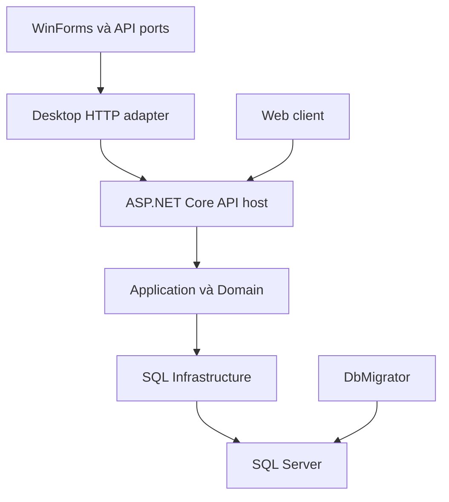

# Đề xuất tổ chức code, repository và runtime

**Phạm vi:** phương án thiết kế dựa trên [khảo sát 24/10/2026](../assessments/2026-10-24-current-state.md). **Trạng thái:** đề xuất; xem [bảng lựa chọn](2026-10-24-adoption.md#1-lựa-chọn). Các tên và đường dẫn tương lai dưới đây chưa phải cấu trúc đã triển khai.

## 1. Đề xuất chính

Tổ chức theo ba nơi chịu trách nhiệm chính:

1. **`MyDmsVn` — sản phẩm:** nghiệp vụ, các client, contracts, mock scenarios và tests; mỗi phần có điểm chạy/build/test phù hợp.
2. **`MyDmsVn.WinFormsKit` — toolkit đề xuất:** gom source Bootstrap5WinFormUI và BootstrapSourceGrid, giữ hai assembly và public identities; tiếp tục pin SourceGrid fork độc lập.
3. **`MyDmsVn.Docs` — quyết định và thiết kế:** mục tiêu sản phẩm, đánh giá, phương án được duyệt và UX dùng chung. Tài liệu đi sát implementation ở repo sở hữu code.

Đây là khuyến nghị giảm phối hợp thừa. Một repo sản phẩm vẫn có thể chứa UI chạy mock không cần SQL và server chạy độc lập. Ngược lại, hai repo vẫn có thể phụ thuộc chặt nếu UI phải lấy server source về mới build được.

Tôi đề xuất **tách điểm chạy, dependency và hợp đồng trước; tách repository sau khi có nhu cầu phát hành độc lập**. Một backend triển khai thành một ứng dụng với các module rõ ràng phù hợp với Sales/Inventory hiện tại. Microsoft cũng mô tả việc tách trách nhiệm trong ứng dụng đơn khối và giữ business core độc lập; số process không quyết định chất lượng phân lớp. [Microsoft architecture guidance][E01].

## 2. Ba phương án thực sự có thể chọn

| Phương án | Tổ chức | Lợi ích | Chi phí / khi phù hợp |
|---|---|---|---|
| **1A — Product repo + WinFormsKit + Docs (khuyến nghị)** | UI/Server/contracts/prototypes cùng repo sản phẩm; toolkit dùng chung tách riêng | Một PR có thể đổi use case và client liên quan; giảm chuỗi UI→adapter; vẫn chạy UI/Server độc lập | Cần solution/test boundaries tốt; phù hợp một Owner hoặc nhóm nhỏ thay đổi xuyên tầng thường xuyên |
| **1B — Client repo + Server repo + WinFormsKit + Docs** | Desktop/Web/mock ở Client; API/Application/SQL ở Server; hợp đồng được version hóa từ Server | Phân quyền, release và ownership độc lập rõ hơn | Thêm phối hợp contract/client version, feed/CI và integration; phù hợp khi API đã được dùng thật và hai bên có nhịp phát hành riêng |
| **1C — Một repo cho cả sản phẩm và toolkit, Docs riêng** | Atomic changes mọi code; SourceGrid vẫn là vendor riêng | Ít checkout nhất; tiện khi toolkit chỉ phục vụ MyDmsVn | Build/test graph lớn nếu không cô lập; khó duy trì toolkit như sản phẩm dùng chung |

Không chọn 1B chỉ để có mock UI: mục tiêu ấy đạt được bằng composition root và project references. Cũng không chọn 1C chỉ vì số repo ít: nếu bộ controls được dùng ở các ứng dụng khác, toolkit vẫn có lifecycle riêng đáng giữ.

**Điều kiện chuyển từ 1A sang 1B:** có người chịu trách nhiệm và lịch phát hành độc lập; hợp đồng HTTP được version hóa; hai client/server build được từ artifact đã phát hành; có kiểm tra tương thích cho các version thực sự cần hỗ trợ; dữ liệu đo cho thấy việc ở cùng repo gây cản trở. Không cần một ngưỡng số file tùy ý.

## 3. Trong repo sản phẩm: độc lập bằng điểm chạy

Giai đoạn đầu giữ tên/đường dẫn project hiện hữu. Tạo solution hoặc solution filter nhỏ và composition root riêng trước khi di chuyển hàng loạt file. Các tên dưới đây là ví dụ để thống nhất mục đích, chưa phải lệnh có thể chạy:

| Điểm làm việc đề xuất | Chứa gì | Không cần khởi động |
|---|---|---|
| `MyDmsVn.Desktop.UiLab.sln` | Contracts, Desktop.Application, WinForms, fake scenarios, UiLab executable | SQL, Local server composition, migrator |
| `MyDmsVn.Desktop.sln` | Desktop host production và các dependencies đúng chế độ | Web prototype |
| `MyDmsVn.Server.sln` | Domain/Application/Infrastructure, server tests, migrator; API sau khi được duyệt | WinForms/SourceGrid/browser |
| `web/prototype/` | Một prototype React/TypeScript với dữ liệu mẫu | SQL, .NET backend |
| Solution tích hợp hiện hữu | Kiểm tra ảnh hưởng xuyên phần khi thực sự cần | Không phải điểm mở mặc định cho mọi chỉnh sửa |

Một solution filter không cắt được dependency đang thật sự tồn tại trong ProjectReference. Nghiệm thu UI Lab phải xác minh graph không tham chiếu Local/Server.* và không gọi database startup. Vendor SourceGrid có thể mang transitive SqlClient; điều đó cần được ghi nhận riêng, không nhầm với yêu cầu connection string.

Khi cần sắp lại folder, dùng các nhóm `src/desktop`, `src/server`, `src/contracts`, `web`, `scenarios`, `tests`. Đây là thay đổi điều hướng; không yêu cầu đổi namespace, package ID và public API cùng lúc. Trong Application/Infrastructure tiếp tục nhóm theo Identity, Catalog, Inventory, Sales; chỉ tạo project mới khi cần compiler boundary hoặc execution boundary thực sự.

### Ranh giới trách nhiệm

| Thành phần | Sở hữu |
|---|---|
| Contracts | DTO/serialization contract hiện hành, error vocabulary, ví dụ xác định; không chứa WinForms, SQL, MediatR requests |
| Desktop.Application | Trạng thái và hành vi presentation, các feature API ports, session/document generation guards |
| Desktop.WinForms | Binding, focus/caret, theme, adapters, accessibility, interaction native |
| UiLab/Fakes | Kịch bản kiểm tra presentation; không phải bản server nghiệp vụ thứ hai |
| Server.Application/Domain | Use case, validation, authorization, posting/costing invariants |
| Server.Infrastructure | Persistence và external adapters; connection/transaction ownership hiện hữu |
| Server.DbMigrator | Schema/versioned SQL theo quy trình triển khai riêng |
| Web client sau này | Presentation của browser; gọi cùng hợp đồng HTTP, không copy costing/security vào client |

Các ranh giới đầu tiên đã phần lớn có trong [project references](https://github.com/chung6a8m/MyDmsVn/blob/03acacdaea6a750aa88b33d61ea139379edcb326/src/MyDmsVn.Desktop.WinForms/MyDmsVn.Desktop.WinForms.csproj) và [feature ports](https://github.com/chung6a8m/MyDmsVn/blob/03acacdaea6a750aa88b33d61ea139379edcb326/src/MyDmsVn.Desktop.Application/FeatureApiClients.cs). Hãy khai thác chúng trước khi phát minh thêm tầng nền tảng.

## 4. Gom toolkit, giữ component boundaries

### Nội dung MyDmsVn.WinFormsKit đề xuất

| Vùng | Nội dung |
|---|---|
| `src/MyDmsVn.Bootstrap5WinFormUI` | Generic controls, rendering, theme, input primitives |
| `src/MyDmsVn.BootstrapSourceGrid` | Bridge giữa controls và engine SourceGrid |
| `vendor/sourcegrid` | Một pin engine/fork và provenance rõ ràng |
| `samples/ControlGallery`, `samples/GridGallery` | Trạng thái controls và grid tương tác, không có nghiệp vụ Sales |
| `tests/` | Core behavior, native controls và adapter compatibility theo phạm vi |

Dependency một chiều: BootstrapSourceGrid → UI core và SourceGrid. UI core không phụ thuộc engine. Toolkit không chứa receipt DTO, session MyDmsVn hoặc quyết định phân quyền.

**Lợi ích cụ thể:** lỗi DateInput sửa ở UI core và kiểm tra adapter có thể đi cùng một changeset. App nhận một revision của toolkit. Vẫn cần kiểm tra integration nhưng bỏ được vai trò repo trung gian chỉ chuyển tiếp pin, như đã thấy trong [DateInput correction](https://github.com/chung6a8m/MyDmsVn/blob/03acacdaea6a750aa88b33d61ea139379edcb326/docs/ui-next/evidence/20261024-dateinput-unified-compact-correction.md#L52-L62).

### Chuyển source và chuyển distribution là hai việc riêng

1. Import lịch sử hoặc lưu mapping commit/provenance có thể truy ngược; giữ notices và public names.
2. Ban đầu vẫn dùng source + ProjectReference. Thay graph/pin trong một thay đổi hẹp, kiểm build và các native cases liên quan.
3. Khi đã sẵn sàng phát hành, mới chọn feed và package boundaries. Giữ hai assembly/package identities; xác định SourceGrid được restore như dependency hay phân phối dưới dạng asset có nguồn gốc rõ ràng.
4. Xác minh license/publication conditions, package-source equivalence, clean restore không dựa cache, lockfiles và tương thích cặp UI/BSG. NuGet.config của app hiện chỉ có nuget.org; feed mới là một thay đổi riêng cần kiểm tra cả transitive dependencies. [Current NuGet configuration][S01], [NuGet source mapping][E02].
5. Chỉ đánh dấu repo cũ read-only/archive sau khi consumer mới, lịch sử và cách quay lại pin cũ đã được chứng minh. Không xóa repo trong lần di chuyển đầu tiên.

BSG hiện có [release gate được ghi trong source][S02]; khảo sát này không xác nhận package đã tồn tại trên feed. Giữ source consumption nếu package chưa đủ điều kiện. Việc tổ chức lại repo không tự giải quyết license hoặc tạo ra bản phát hành tương thích.

## 5. Server độc lập: chọn thời điểm hợp lý

UI Lab giải quyết tốc độ phát triển UI ngay trên net48. HTTP server giải quyết mục tiêu khác: một authority nghiệp vụ được triển khai riêng, khả năng dùng Web và giảm việc phát credentials SQL tới client.

Đích đề xuất, khi được chọn:

Đây là **runtime tương lai**, chưa phải topology hiện tại. Backend vẫn là một modular monolith; Identity, Catalog, Inventory và Sales giữ module boundaries trong cùng backend. Posting liên quan receipt/sales/inventory hiện cần một transaction protocol; tách database/service cho từng module lúc này tạo thêm bài toán nhất quán mà người dùng chưa cần.

### Runtime cần quyết định rõ

| Phần | Đề xuất |
|---|---|
| Desktop đang giao hàng | Tiếp tục `net48` trong các bước UI/docs/tests/toolkit |
| API mới có vòng đời dài | Ưu tiên .NET 10 LTS, sau khi chấp nhận toolchain và kiểm compatibility |
| Shared pure libraries | Đánh giá `netstandard2.0` hoặc multi-target chọn lọc nếu thật sự phục vụ cả net48 và modern host |
| Server Infrastructure | Audit provider/API/OS dependencies rồi mới retarget hoặc multi-target; không mặc định chuyển cả tầng sang .NET Standard |
| IDE | VS2022 cho desktop; API net10 dùng VS18+/Visual Studio 2026 hoặc workflow CLI/VS Code được hỗ trợ |

Tại 24/10/2026, .NET 8 và .NET 9 hết hỗ trợ ngày **10/11/2026**, .NET 10 LTS được hỗ trợ tới **14/11/2028**. Đây là lý do không chọn .NET 8 làm đích lâu dài cho API mới. `.NET Framework 4.8` có lifecycle khác, theo Windows được hỗ trợ; không được đồng nhất net48 với .NET 8. [Runtime support][E03], [Framework support][E04].

Microsoft chỉ hỗ trợ target `net10.0` trong Visual Studio 18.0+; cài SDK 10 không tự biến VS2022 thành IDE hỗ trợ target đó. [SDK/VS compatibility][E05]. Current [global.json][S03] chọn SDK 8.0.400 với `latestFeature`, và root props áp C#12/analyzers/warnings-as-errors. Nếu cùng repo có hai toolchains, phải xác định solution, working directory, SDK được resolve, props và lockfile áp dụng cho từng đường build. Chỉ đặt thêm global.json trong subfolder chưa chứng minh isolation.

Không giữ hai bản copy của business rules để phục vụ hai runtime. Làm một compatibility spike hẹp: build các tầng cần thiết, chạy một use case trên graph mới, so parity với Local. Nếu không thể dùng chung source an toàn trong phạm vi đã chọn, dừng và quyết định chiến lược runtime trước khi mở rộng API.

## 6. Hợp đồng HTTP và client là phần cần đầu tư

### Một nguồn cho hình dạng giao tiếp

Hiện Contracts C# và `ApiJson` là nguồn source thực. Khi API ra đời, đề xuất code-first: API tạo một OpenAPI artifact, clients/mocks dùng artifact đó; không duy trì thêm một OpenAPI viết tay lệch code. ASP.NET Core hỗ trợ sinh OpenAPI cho controller và Minimal API. [OpenAPI documentation][E06].

Chọn một generator phù hợp cho C#/TypeScript sau spike, pin version và kiểm output build được trên net48. Không bắt buộc đưa nhiều generators/frameworks vào ngay. Generated client là adapter hạ tầng, không đưa generated internals vào ViewModel hoặc server Domain. Một OpenAPI hợp lệ chỉ chứng minh tài liệu đúng cấu trúc; muốn phát hiện shape drift phải đối chiếu artifact/generated clients với payload HTTP thật. Đặc biệt, schema generator phải mô tả đúng envelope và custom converters của serializer đang chạy; không mặc định cấu hình OpenAPI đã đồng nhất với MVC/Newtonsoft. [Cấu hình metadata/schema của Microsoft][E09]. Các kiểm tra shape này vẫn không chứng minh rounding, authorization hoặc transaction correctness.

Một artifact hợp đồng có version đủ dùng; chưa tạo thêm một repo Contracts chỉ để chứa vài DTO. Nếu chọn 1B sau này, Server sở hữu artifact hợp đồng, Client pin version và có compatibility policy rõ ràng.

### Các quyết định bắt buộc trước client Web thật

| Chủ đề | Điều phải chốt và kiểm chứng |
|---|---|
| `long` identifiers | Không để JavaScript làm tròn ID lớn; chọn biểu diễn wire/string hoặc parser/limit có tài liệu và test |
| Decimal quantity, price, amount | Biểu diễn và thuật toán preview phải giữ chính xác; có thể dùng chuỗi decimal hoặc fixed-point theo schema; không mặc định dùng JS number cho mọi giá trị |
| Date-only | SaleDate/FromDate/ToDate giữ `yyyy-MM-dd`, không đổi múi giờ như UTC audit timestamps |
| Rowversion/cursor | Opaque tokens; cursor không cấp quyền, đổi filter làm mất hiệu lực lịch sử paging tương ứng |
| Errors | Giữ code, field paths, ý nghĩa 401/403/409 và envelope; không đổi âm thầm semantics Local |
| Serialization | `ApiJson` hiện dùng Newtonsoft và custom converters; kiểm cấu hình API serializer hoặc mapping sang wire DTO riêng |
| Nullability | Draft chưa có posted-cost/profit, Posted có giá trị authoritative; schema/client phải phản ánh đúng |

Nguồn hiện trạng: [SalesContracts][S04], [contract conventions][S05]. JSON với các implementation số phổ biến chỉ bảo đảm đồng thuận số nguyên trong khoảng an toàn ±(2^53−1); đó là vấn đề interoperability thật, không được giải quyết bằng việc generator sinh thuộc tính `number`. [RFC 8259 §6][E07].

Nếu đổi biểu diễn HTTP so với JSON hiện tại, dùng version/adapter explicit và golden cases. Không sửa ngầm toàn bộ Local contract chỉ để React dễ dùng. `net48` không tham chiếu được assembly `net10.0`; chỉ chia sẻ library khi target/APIs tương thích. .NET Standard 2.0 là điểm cần đánh giá cho .NET Framework, không phải 2.1. [Microsoft .NET Standard][E08].

### Authentication và kết quả lệnh chưa xác định

Remote server tạo trusted identity từ cơ chế authentication được duyệt. Session generation/`ForSession(long)` hiện là guard của client, không phải credential được tin từ request. Cần quyết định token/session expiry, revocation, disabled user, logout và cách bảo vệ browser; không mặc định coi serialize DesktopSession là đủ.

Một Remote package phải loại database credentials và Server.Infrastructure composition. Không âm thầm fallback sang direct SQL khi API lỗi, 401 hoặc mất mạng. Local và Remote là hai chế độ triển khai được chọn rõ ràng.

Giữ trạng thái `RequiresPostOutcomeReload`: connection mất sau commit không đồng nghĩa rollback. Ban đầu không tự retry CreateDraft/Save/Post. Kiểm tra kết quả qua luồng recovery có quyền phù hợp; nếu không được quyền reload thì vẫn giữ trạng thái bảo vệ. Rowversion hoặc xử lý AlreadyPosted không tự tạo idempotency cho mọi command. Nếu muốn replay an toàn, đó là hợp đồng riêng cần thiết kế sau.

## 7. Làm thế nào để việc mở rộng đơn giản hơn?

Một feature mới đi theo đường ngắn: ghi hành vi và ví dụ → thống nhất UI states/hợp đồng → implementation ở module sở hữu → tests tại ranh giới có rủi ro → cập nhật tài liệu hiện hành đúng một nơi. Có thể review UI bằng fake data trước khi SQL implementation xong.

Áp dụng các nguyên tắc nhỏ:

- Giữ Clean Architecture ở dependency direction; không tạo interface/class chỉ để đủ sơ đồ tầng.
- Giữ explicit UoW và business repositories hiện có; không đổi provider/resolver đồng thời với cấu trúc repo.
- Toolkit chỉ nhận generic semantics; quy tắc dirty/permission/Post thuộc app.
- Shared code phải có ít nhất một nhu cầu dùng chung cụ thể và ownership rõ; không biến SharedKernel thành nơi bỏ mọi thứ.
- Một task có một kết quả có thể xem được và bộ kiểm chứng tối thiểu tương ứng. Không mở lại toàn bộ acceptance lịch sử mỗi lần sửa giao diện.
- Không đổi runtime, API shape, repo layout, package distribution và SQL schema trong cùng một PR tổ chức lại.

Trình tự thực hiện và tiêu chí quay lại nằm ở [lộ trình áp dụng](2026-10-24-adoption.md). Cách thử UI và các giới hạn portability nằm ở [UI prototyping](2026-10-24-ui-prototyping.md).

## Nguồn bổ sung

[S01]: https://github.com/chung6a8m/MyDmsVn/blob/03acacdaea6a750aa88b33d61ea139379edcb326/NuGet.config
[S02]: https://github.com/chung6a8m/MyDmsVn.BootstrapSourceGrid/blob/e311144c27cd79a6c34aa0308ad029651c9e03c9/docs/RELEASE.md#L3-L11
[S03]: https://github.com/chung6a8m/MyDmsVn/blob/03acacdaea6a750aa88b33d61ea139379edcb326/global.json
[S04]: https://github.com/chung6a8m/MyDmsVn/blob/03acacdaea6a750aa88b33d61ea139379edcb326/src/MyDmsVn.Contracts/SalesContracts.cs
[S05]: https://github.com/chung6a8m/MyDmsVn/blob/03acacdaea6a750aa88b33d61ea139379edcb326/docs/CONTRACTS.md
[E01]: https://learn.microsoft.com/en-us/dotnet/architecture/modern-web-apps-azure/common-web-application-architectures
[E02]: https://learn.microsoft.com/en-us/nuget/consume-packages/package-source-mapping
[E03]: https://dotnet.microsoft.com/en-us/platform/support/policy/dotnet-core
[E04]: https://dotnet.microsoft.com/en-us/platform/support/policy/dotnet-framework
[E05]: https://learn.microsoft.com/en-us/dotnet/core/porting/versioning-sdk-msbuild-vs
[E06]: https://learn.microsoft.com/en-us/aspnet/core/fundamentals/openapi/overview?view=aspnetcore-10.0
[E07]: https://www.rfc-editor.org/rfc/rfc8259#section-6
[E08]: https://learn.microsoft.com/en-us/dotnet/standard/net-standard

[E09]: https://learn.microsoft.com/en-us/aspnet/core/fundamentals/openapi/include-metadata?view=aspnetcore-10.0
